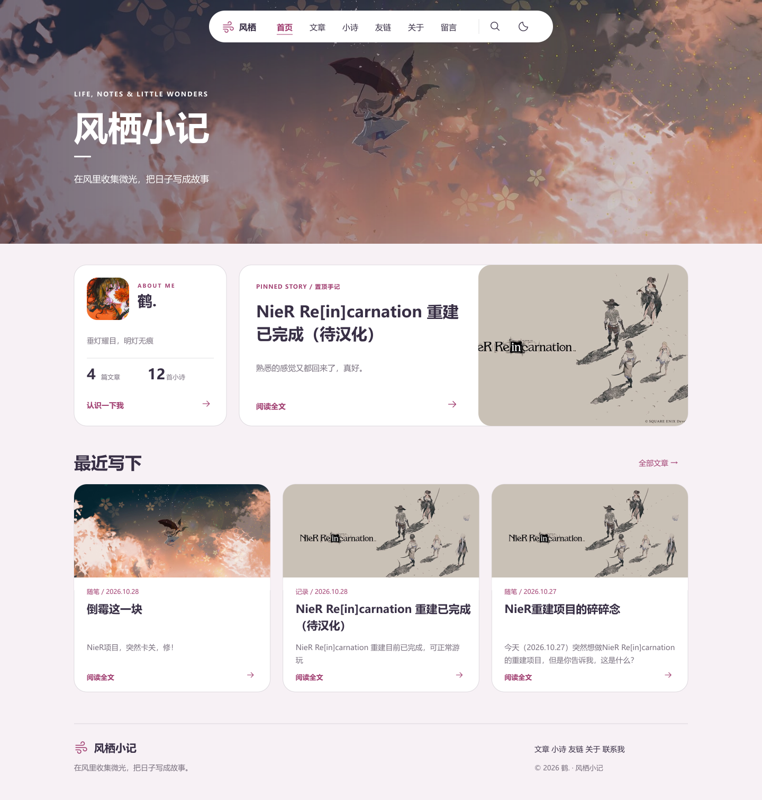

# 风栖小记

风栖小记是一份网页设计课程作品，以个人博客为主题，收录文章、小诗和友链。网站使用 HTML5、CSS3 和原生 JavaScript，可以直接在浏览器中打开。

[浏览网站](./02-网站源码/index.html) · [查看设计稿](./01-设计稿/index.html) · [GitHub 参考项目](https://github.com/TYC3301-1162-1/fonscape-blog)

## 界面预览

桌面首页设计稿展示了头图、导航、作者信息和文章卡片。设计稿展示页还收录了文章列表与留言页的桌面和移动端版本、第一版结构草图及设计规范。



## 主要功能

- **文章浏览**。按分类筛选或搜索文章，从列表进入详情页，点击配图可打开灯箱。
- **小诗与友链**。小诗支持展开阅读，友链页集中展示站点链接。
- **响应式布局**。页面适配桌面和手机，移动端可折叠菜单，明暗主题会记住当前浏览器的选择。
- **留言演示**。表单会校验必填项和邮箱格式。经用户同意后，留言保存在当前浏览器，邮箱仅用于校验。

## 快速开始

双击 `02-网站源码/index.html` 即可浏览，无需安装依赖。也可在本目录启动 Python 静态服务器：

```powershell
py -m http.server 8000 --directory "02-网站源码"
```

启动后访问 [http://localhost:8000](http://localhost:8000)。如需通过 GitHub Pages 发布，将 `02-网站源码/` 作为站点根目录。

## 项目文件

| 路径 | 内容 |
| --- | --- |
| [01-设计稿/](./01-设计稿/) | 首页、文章列表和留言页的桌面与手机设计稿，附 PNG、SVG 和设计规范 |
| [02-网站源码/](./02-网站源码/) | 11 个 HTML 页面，以及共用样式、交互脚本和图片 |
| [03-设计说明文档.docx](./03-设计说明文档.docx) | 选题、目标用户、信息架构、视觉设计与方案迭代 |
| [04-技术说明文档.docx](./04-技术说明文档.docx) | 功能实现、文件组织、测试记录和部署方法 |

## 测试与素材

已使用 Chromium 检查 11 个页面在 375、768、1200、1440 像素宽度下的布局，共 44 组。交互测试包括文章分类、搜索、加载更多、图片灯箱、菜单、主题切换及留言校验。独立浏览器的测试状态详见技术说明文档。

课程版采用静态页面实现，界面参考 GitHub 上的 Fonscape 项目。文章、小诗及配图的出处见[素材来源页](./02-网站源码/sources.html)。
